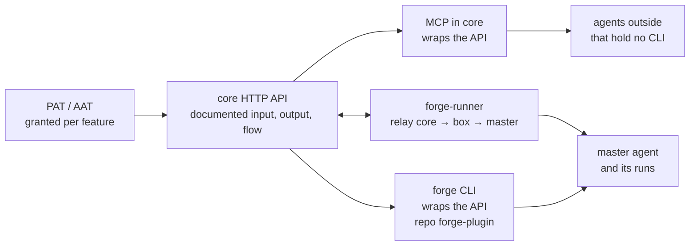

# forge-dev focus: the API is the product, and everything else wraps it

The owner set this direction on 2026-09-30. It says which parts of this repository forge-dev spends
its work on, and what role each part plays. Work that fits none of these roles is not taken while
this holds.

## The four parts, and the role of each

| Part | Role | What is taken | What is not |
|---|---|---|---|
| `packages/core` HTTP API | the product surface. An API plus a token can drive and use every feature | every capability is a route; every route can be granted to a PAT or an AAT | a feature reachable only from the UI or only from MCP |
| `packages/runner` | the relay from core to the box to the master agent | stability, and enough visibility to watch the master agents | runner features beyond relaying and watching |
| forge CLI (repo forge-plugin) | a thin wrapper over the API for agents that run a shell, the runner's master included | commands that call the API | logic the API does not have. That goes into core first |
| MCP (in core) | a wrapper over the API, the same way the CLI is | tools that agents need natively, or that outside agents need without a CLI | a tool for work a CLI already does on a box with a shell |

**The backend comes first, and the UI is not a focus** (owner, 2026-09-30: "hiện tại flow mục tiêu
hoàn thiện core và các phần BE này trước, chưa cần focus UI"). `packages/web-v2` is not one of the
four. While this holds, it takes fixes that block the parts above, and nothing more.

## Measured against main on 2026-09-30

**Every API mount is in the token grant grammar or named out of it** (ISS-1373, 2026-10-01).
`auth/pat-permissions.ts:PAT_PERMISSION_RESOURCES` is the one list of what a token can be granted:
16 resources, each `project` reach (a project-scoped token may hold it, and `check-pat-surface`
proves every route under it fenced) or `account` reach (only a token with no project list may hold
it). `PAT_UNGRANTABLE` beside it names every path kept out, each with its reason: public routes,
the browser session's own lifecycle under `/api/auth`, token management at `/api/pat`, signed
webhooks, ticketed uploads, the GitHub install redirect, the MCP transport, and the paired box's
own device routes. Each entry also names the door it does admit (`PAT_EXCLUSION_DOORS`), and a
personal or agent token sent there, where its router runs the token door, is refused with that
door's advice. A device entry lets the box's own credential past the token door, so a guard
mounted ahead of a device route leaves the route's device gate to decide.
`middleware/pat-mount-coverage.test.ts` reads the composed app's routes and
fails naming any route under neither list, and any route under a menu prefix that a token cannot
reach — with every door on the request's chain run, so a guard mounted earlier cannot answer for
the route's own. It also sends each public entry no credential and each device entry a device
credential, and refuses a router mounted at `/` or `/api` that runs middleware over every path
beneath it.

Still open: routers mounted at one shared prefix, `/api/projects` above all, each carry a
`use('*')` guard, so a router's guard runs for every sibling mounted after it. The coverage test
sees through it, and every such guard there today is `requireAuth()` with `assertEmailVerified()`,
which admits what each route behind it admits; what it costs is that a route's own gate is not the
first one it meets.

A token keeps the reach it was minted with: each prefix carries the grant epoch it joined at and
each token the epoch it was minted at, so a token issued before a prefix joined the menu is refused
there, whatever it was granted.

**The API publishes its own reference** (ISS-1371). `GET /api/openapi.json` serves an OpenAPI 3.1
document built from the composed app's route table, `GET /api/reference` renders it and
`GET /api/reference/flows` draws the four flows an agent drives; none needs a credential, and each
is named out of the token grant with its reason in `auth/pat-permissions.ts:PAT_UNGRANTABLE`. Every
route is an operation carrying the input schemas its handler validates with (read from the
validator the route runs through, `middleware/validator.ts:zValidator`, or declared with
`declaresInput` where the handler parses its own), every status it can answer with a schema or the
error envelope and the codes it can give, and the permission or the named exclusion that reaches it.
`api-reference/reference.test.ts` runs in the core unit job over the composed app and names the
route that has no declared answer, reads an input no schema declares, throws a status or code its
descriptor omits, carries a schema JSON Schema cannot hold, or is the step of a flow that names no
route. It holds no baseline of gaps. A handler's body agreeing with its schema is held two ways: `tsc`
refuses a body the declared schema does not accept (`api-reference/describe.ts:answer`), and the
integration run, with `RESPONSE_CONFORMANCE=1`, fails a request whose JSON answer does not validate
against the schema declared for its status. That run is a post-merge job (ISS-1370), so what the
integration suite does not exercise is held by `tsc` alone.

**MCP reaches the database beside the API.** 19 of the 49 tool files under
`packages/core/src/mcp/tools/` import the database module directly, for example
`forge-issues.ts`, `forge-jobs.ts` and `forge-runners.ts`. Whether each one duplicates a route or
shares its service is what the audit answers. What it must end at is one path per capability:
a tool calls what the route calls.

## What this direction owes

1. **Every feature mount grantable to a token** (ISS-1373). An exclusion is refused unless it is named with its
   reason.
2. **MCP and the CLI on the API's path** (ISS-1372; the CLI half is reached by issue in forge-plugin). A capability has one implementation, and every wrapper
   calls it.

## Honest costs

| The choice | What it costs |
|---|---|
| Backend first, UI not a focus | the web UI falls behind the API. A capability can land with no screen, and a person reads it through the CLI, MCP or the API reference until the UI catches up |
| Every feature grantable to a token | each new route must name its permission before it merges, and each exclusion must carry a reason. A feature can no longer ship behind the session cookie alone |
| MCP and the CLI only wrap the API | a capability that exists only in an MCP tool or a CLI verb today has to move into core first. Until it does, the wrapper is the one path, and this direction counts that as a defect |
| A reference generated and checked in CI | a route whose schema is loose, or whose output is shaped by hand, fails the check until it is typed, and a route's answer is written once as a schema beside its router. Refactors pay that at the moment they touch a route |
| Runner limited to relay and watching | runner features that someone wants wait. Their value is real, and they are out of focus while this holds |

The issues named above track that work. What is built today, and in what order, belongs to the
tracker and not here.
